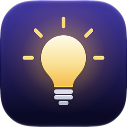
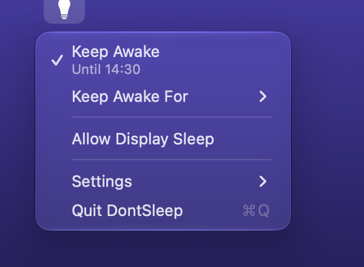
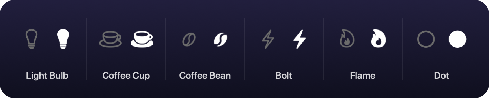

<div align="center">



# DontSleep

### Keep your Mac awake. One click, or one command.

A tiny menu bar app that stops your Mac from sleeping while a download, a build or an AI agent is still at work.<br>
**Native Swift and AppKit. About 13 MB of memory. 0% CPU. No account, no analytics. Free and open source.**

[](https://github.com/burakgon/dontsleep-mac/releases/latest)
[](#install)
[](#install)
[](#how-it-works)
[](https://github.com/burakgon/dontsleep-mac/actions/workflows/ci.yml)
[](LICENSE)

[**Download for macOS**](https://github.com/burakgon/dontsleep-mac/releases/latest/download/DontSleep.dmg) · [Features](#features) · [Command line](#command-line) · [Install](#install) · [FAQ](#faq) · [Build it yourself](#build-it-yourself)

<br>



</div>

<br>

Click the icon in the menu bar and choose **Keep Awake**. Your Mac stays awake until you turn it off
again, or for as long as you say. That is the whole app.

## Why

A Mac that is left alone goes to sleep, and takes the download, the build, the backup or the coding
agent that was still running down with it. macOS can be told not to, with `caffeinate` in a Terminal
window that then has to stay open.

DontSleep is that, as a switch in the menu bar and as a command your scripts and agents can call.
It is built for macOS 26 and later and it is careful with your Mac: it asks macOS to stay awake
once, and then does nothing at all until you tell it otherwise.

|               |                                                                                 |
| ------------- | ------------------------------------------------------------------------------- |
| Built with    | Swift 6 and AppKit. The menu is an ordinary macOS menu, so it is Liquid Glass   |
| Memory        | about 13 MB after launch, about 20 MB once its menu has been opened             |
| CPU           | 0%. No timer ticks, nothing is polled. It holds one power assertion and waits   |
| Download      | 3 MB                                                                            |
| Command line  | `dontsleep on --for 2h`, with JSON output for scripts and AI agents             |
| Updates       | by itself, signed with Developer ID, notarized by Apple                         |
| Price         | free, [MIT license](LICENSE)                                                    |

## Features

### One click

**Keep Awake** in the menu turns it on and off. A **right-click** on the icon does the same without
opening the menu, and so does a click with <kbd>⌥</kbd> or <kbd>⌃</kbd> held.

### For a while

**Keep Awake For** takes 15 minutes to 8 hours and turns itself off afterwards. The menu shows when:
*Until 14:30*. It goes by the clock, so it ends on time even if you put the Mac to sleep by hand in
between.

### Screen off, Mac awake

With **Allow Display Sleep** the screen dims and turns off as usual, and locks if you have set it
to, while the Mac underneath keeps running. That is the setting for work that goes on overnight.
Without it the screen stays on too.

### An icon you choose

The first time you open DontSleep it asks which icon you would like in the menu bar. There are six,
and **Settings › Menu Bar Icon** changes it later: point at one and it tries it on in the menu bar.



Each is one shape, outlined and dim while your Mac sleeps as usual and filled in while it is kept
awake. The two forms sit in exactly the same place, so the icon never jumps when the state changes.

### It looks after itself

DontSleep updates in the background and restarts itself when that disturbs nobody: never while it is
keeping your Mac awake. **Settings › Update Automatically** turns this off.

## Command line

DontSleep comes with `dontsleep`, a command that controls the app from a shell. It is meant for
scripts and for AI coding agents, which can keep the Mac awake for as long as their job takes.

```console
$ dontsleep on --for 2h --display-sleep
on until 16:30 (2h left), display may sleep

$ dontsleep status
on until 16:30 (1h 59m left), display may sleep

$ dontsleep off
off
```

| Command                             | What it does                                                     |
| ----------------------------------- | ---------------------------------------------------------------- |
| `dontsleep on`                      | Keep the Mac awake until `dontsleep off`                         |
| `dontsleep on --for 45m`            | ...for a while: `90s`, `45m`, `2h`, `1h30m`, `1d`                |
| `dontsleep off`                     | Let the Mac sleep again                                          |
| `dontsleep toggle`                  | On when off, off when on                                         |
| `dontsleep status`                  | Say whether the Mac is being kept awake                          |
| `dontsleep display-sleep on\|off`   | Let the display sleep meanwhile, or keep it on too               |
| `dontsleep quit`                    | Quit the app                                                     |

`on` and `toggle` also take `--display-sleep` and `--no-display-sleep`. Every command prints the
state it leaves behind, and with `--json` prints it for a program to read:

```console
$ dontsleep status --json
{"active":true,"displaySleepAllowed":true,"remainingSeconds":7140,"running":true,"until":"2026-11-10T13:30:00Z","version":"1.0.0"}
```

The keys are always the same six; `until` and `remainingSeconds` are `null` when there is no end.
A command exits with 0 when it did what it was asked, 1 when it could not, and 64 when it was not
understood. `on` starts the app if it is not running, and it all works over SSH as well.

To put the command on your `PATH`, choose **Settings › Command Line Tool** in the menu. It makes a
link in `/usr/local/bin`, in Homebrew's `bin` or in `~/.local/bin`, whichever you can write to.
Without that, the command is at `/Applications/DontSleep.app/Contents/Helpers/dontsleep`.

### For agents

A line like this in the instructions of Claude Code, Codex or any other agent is enough:

```text
Before a long-running task, run `dontsleep on --for 3h --display-sleep` so the Mac does not go to
sleep under you. Run `dontsleep off` when you are done.
```

The time limit is the safety net: an agent that forgets the second half leaves no Mac awake forever.

## Install

1. Download [**DontSleep.dmg**](https://github.com/burakgon/dontsleep-mac/releases/latest/download/DontSleep.dmg).
2. Open it and drag DontSleep to Applications.
3. Open DontSleep. It asks which icon you would like and whether it should open when you log in.

It needs macOS 26 or later and runs on Apple silicon and Intel. The app is signed with Developer ID
and notarized by Apple, so it opens without a warning.

To remove it, quit DontSleep and move it to the Trash. It keeps nothing but its settings, in
`~/Library/Preferences/com.burakgon.DontSleep.plist`.

## FAQ

**Does it keep a MacBook awake with the lid closed?**<br>
No. Closing the lid puts a MacBook to sleep whatever any app says, unless a display and power are
connected. The same goes for **Sleep** in the Apple menu and for an empty battery. DontSleep stops
the sleep that comes from leaving the Mac alone.

**How do I know it is working?**<br>
The icon is filled in, and macOS says so itself: `pmset -g assertions` lists DontSleep under
`PreventUserIdleDisplaySleep`, or `PreventUserIdleSystemSleep` with Allow Display Sleep. Activity
Monitor shows *Yes* for DontSleep in the Preventing Sleep column of its Energy tab.

**What if DontSleep quits or crashes while it is on?**<br>
Then your Mac sleeps as usual again. macOS ties the request to stay awake to the app that made it
and drops it the moment that app is gone. Nothing is left behind and no setting of the system is
changed.

**Is this different from `caffeinate`?**<br>
It asks macOS for the same thing, in the same way. `caffeinate` lasts as long as its Terminal
window; DontSleep is a switch you can see, with a timer, that an agent can also reach.

**Does it use the battery?**<br>
The app itself does not: it runs no code while it waits. A Mac that is awake uses more energy than
one that sleeps, which is the point, so give it a time limit when you are not plugged in.

**Does it collect anything?**<br>
No. It makes one kind of request: once a day it asks GitHub whether there is a newer version.

## Build it yourself

You need Xcode 27 or later.

```sh
git clone https://github.com/burakgon/dontsleep-mac.git
cd dontsleep-mac
open DontSleep.xcodeproj      # then Product > Run
```

Or from the command line:

```sh
xcodebuild -project DontSleep.xcodeproj -scheme DontSleep -configuration Release \
    -derivedDataPath build/DerivedData build
open build/DerivedData/Build/Products/Release/DontSleep.app

swift test --package-path Packages/DontSleepKit      # the tests
```

No Apple developer account is needed: the app is signed ad hoc unless
[`Config/Local.xcconfig`](Config/Base.xcconfig) says otherwise.
[`scripts/release.sh`](scripts/release.sh) builds, signs, notarizes and publishes a release.

## How it works

- **Staying awake** is one IOKit power assertion: `PreventUserIdleDisplaySleep`, or
  `PreventUserIdleSystemSleep` when the display may sleep. Holding it costs nothing, and macOS
  releases it by itself if the app ever goes away.
- **A timed session** is one timer that fires once, set to the wall clock.
- **The menu** is a plain `NSMenu` of ordinary items. macOS draws it, highlights it and reads it
  aloud; the app only brings it up to date when it is about to open.
- **The command** talks to the app over a Unix socket in `~/Library/Application Support/DontSleep`
  that only your account can open. An idle socket costs nothing either: the kernel wakes the app
  when a command connects.
- **Updates** come through [Sparkle](https://sparkle-project.org): an appcast on GitHub Releases,
  checked once a day. An update must carry both the Developer ID signature and the signature of
  the update key before it is installed.

The code is in three places: [`Packages/DontSleepKit`](Packages/DontSleepKit) holds everything that
has no interface and is tested, [`DontSleep`](DontSleep) is the app, and [`CLI`](CLI) is the command.

## License

[MIT](LICENSE). Copyright © 2026 Burak Goncu.
